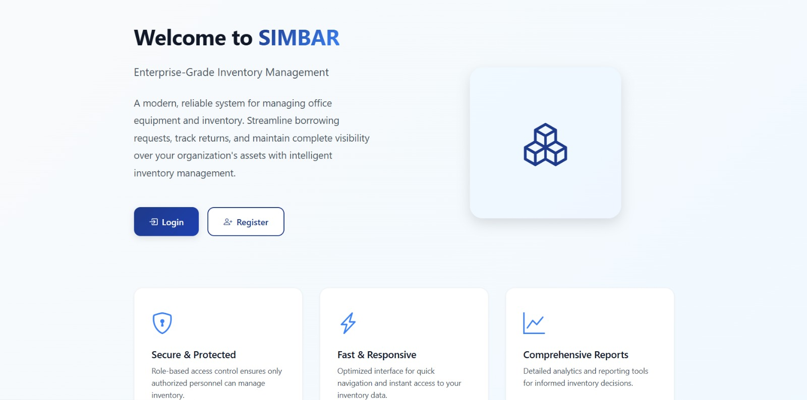
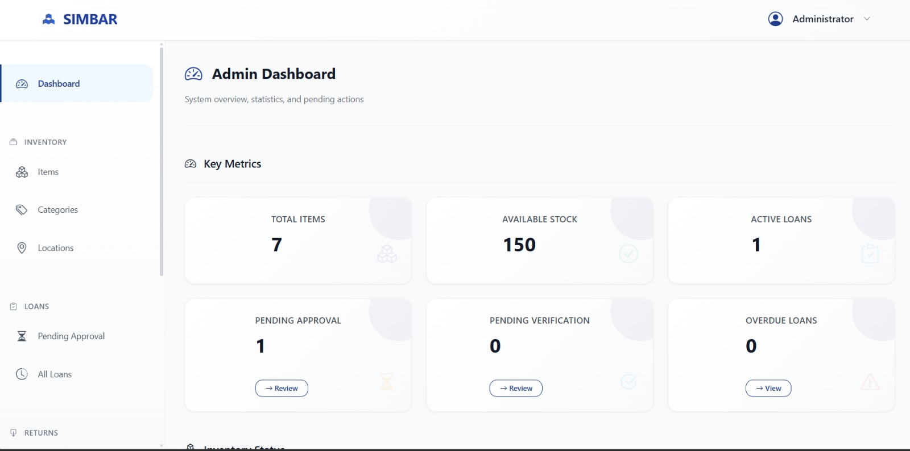
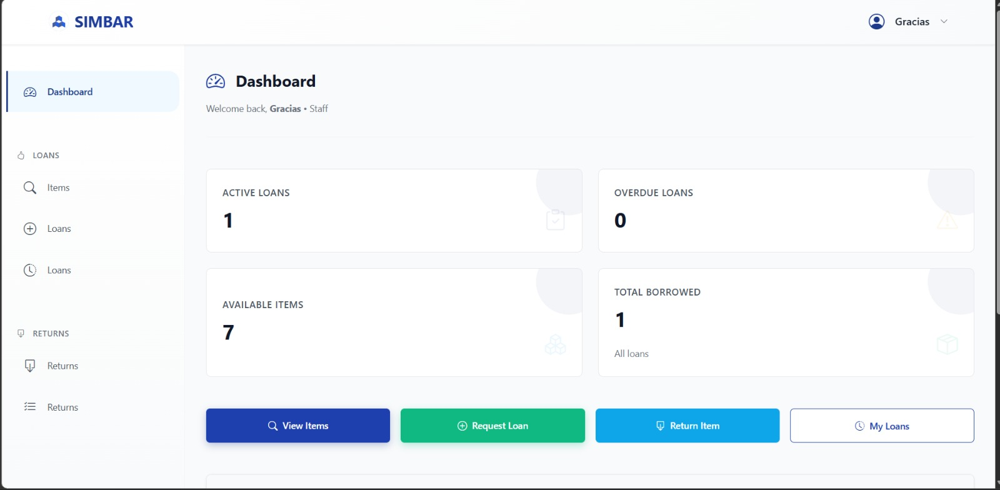
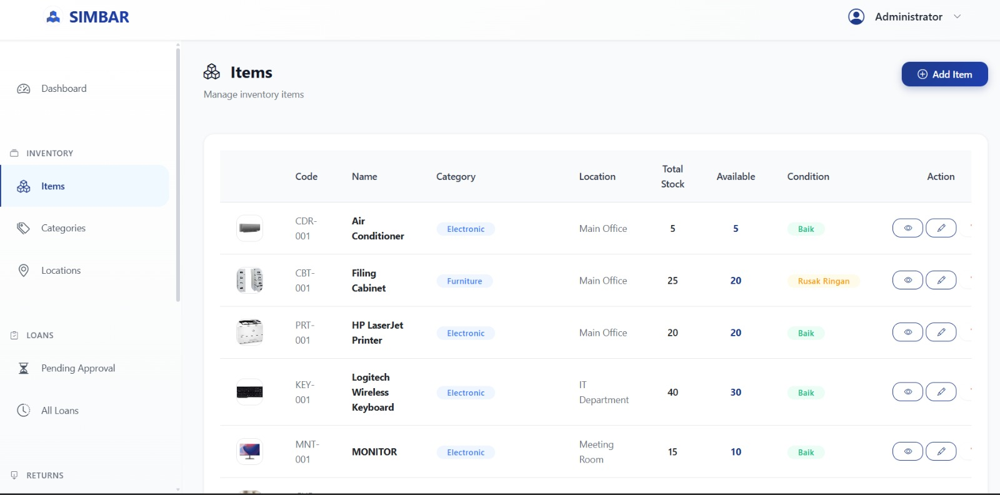
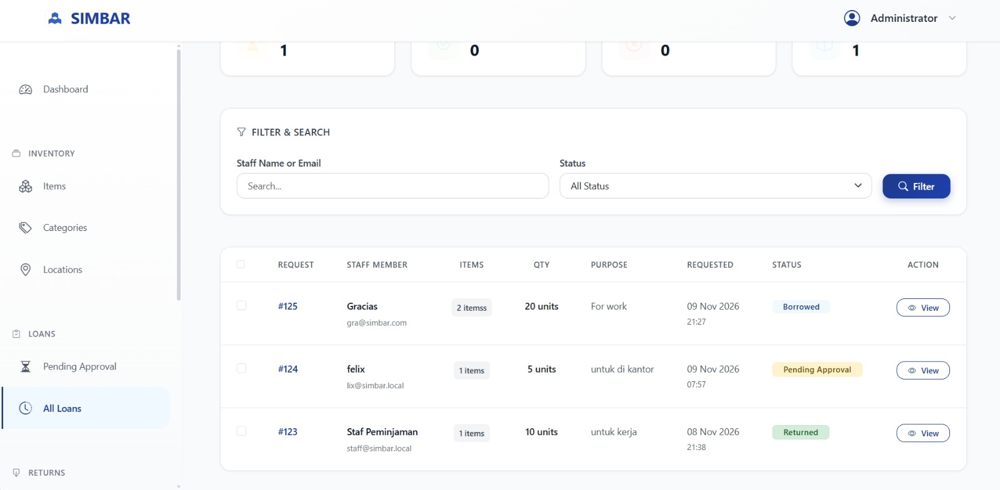
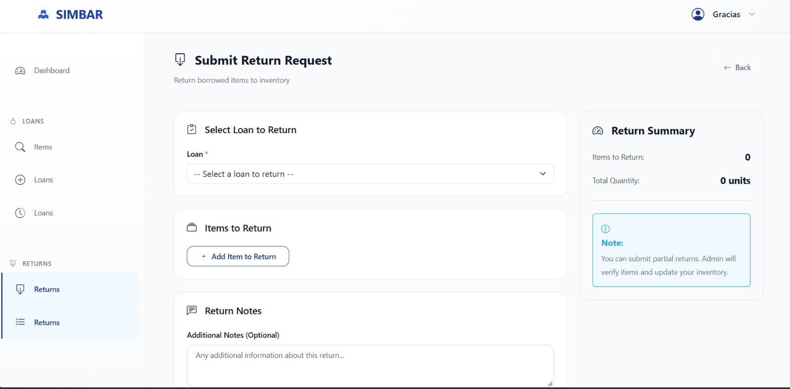

SIMBAR — Sistem Informasi Inventaris Barang

  

  <strong>Office Inventory Management System</strong>

  A web-based application for managing office inventory, monitoring stock, and handling borrowing and returning processes.

  
  
  
  
  

📖 About SIMBAR

SIMBAR (Sistem Informasi Inventaris Barang) is a web-based office inventory management system designed to simplify the process of managing company assets and equipment.

The application helps administrators manage inventory data, monitor stock availability, approve borrowing requests, verify returned items, and generate inventory reports.

SIMBAR provides two main user roles: Admin and Staff, each with different access permissions.

## Application Preview

### Welcome Page

### Admin Dashboard

### Staff Dashboard

### Inventory Items

### Loan Management

### Return Verification

✨ Key Features

Admin

Dashboard with inventory statistics.

Manage inventory items.

Manage categories and locations.

Add, edit, view, and delete inventory data.

Monitor available and borrowed stock.

Approve or reject borrowing requests.

Verify item returns.

Monitor overdue borrowing.

View inventory and borrowing reports.

Staff

Personal dashboard.

Browse available inventory items.

View item details and stock availability.

Submit borrowing requests.

Track borrowing request status.

Submit item return requests.

View borrowing history.

System

Authentication and authorization.

Role-Based Access Control (RBAC).

Stock availability tracking.

Borrowing and returning workflow.

Item image upload.

Responsive user interface.

👥 User Roles

Role

Permissions

Admin

Manage inventory, categories, locations, borrowing approvals, returns, and reports.

Staff

Browse inventory, submit borrowing requests, submit returns, and view borrowing history.

🔄 Application Workflow

Staff logs into the application.

Staff browses available inventory.

Staff submits a borrowing request.

Admin reviews the borrowing request.

Admin approves or rejects the request.

The system updates stock availability after approval.

Staff submits a return request.

Admin verifies the returned items.

The system updates inventory stock accordingly.

🛠️ Technology Stack

Technology

Purpose

Laravel

Backend Framework

PHP 8.4

Server-side Programming

MySQL

Database Management

Blade

Template Engine

Bootstrap 5

Frontend Framework

HTML5

Website Structure

CSS3

Website Styling

JavaScript

Interactive Functionality

Vite

Asset Bundling
